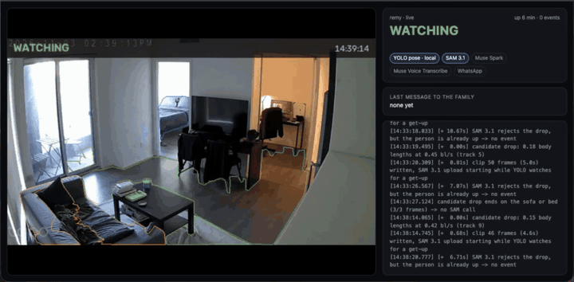
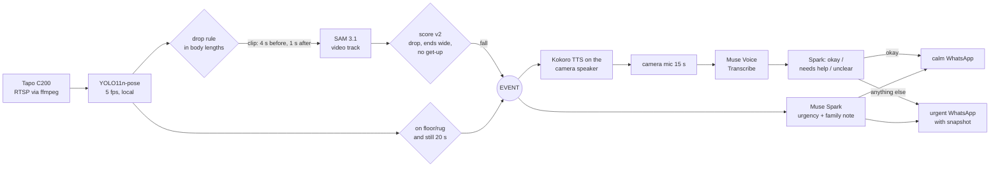

# remy

A fall detector for one elderly person at home, built on a cheap Wi-Fi camera and the Meta Model API.
It watches the room, confirms a fall, asks "Nani, are you okay?" through the camera speaker, listens to
the answer, and tells the family on WhatsApp what happened and what she said. It is a multi-model pipeline
with deterministic checks between the models: a local pose model and a rule decide when to call SAM 3.1,
a second rule on the SAM track decides whether it was a fall, and only then do Muse Spark and Muse Voice
Transcribe write the note, hear the reply and judge it. Evaluated on 100 public clips and on the real camera.

## Hackathon submission (Meta Global AI Developer Hackathon, Oct 26 to Nov 4, 2026)

- **Track and problem statement:** Indie Developer · Build for Your World.
- **Provenance:** built from scratch during the hackathon window. The first commit is Oct 29; every commit in
  this repository is hackathon work. The only thing that existed before was the camera on the shelf.
- **Meta models at runtime:** SAM 3.1 (Meta Model API) tracks the person in the candidate clip and segments the
  room zones · Muse Spark 1.3 (Meta Model API) judges the fall, writes the family note and classifies the spoken
  reply · Muse Voice Transcribe (Meta Model API) turns the reply into text. Muse Spark Open (open weights, via
  Fireworks) was evaluated as a drop-in alternative for the triage stage, clip for clip against Spark 1.3, in
  [`eval/TRIAGE_COMPARE.md`](eval/TRIAGE_COMPARE.md); it is not in the default pipeline.
- **Bonus categories targeted:** Best Agentic Use-Case (it detects, confirms, asks, listens, decides, escalates
  and re-checks without a person in the loop) · Most Viral Project on X · Community Vote.
- **3-minute demo video:** link to come.
- **Keyless verification:** `remy replay examples/event_gmdcsa_S1_Fall_12` replays a recorded live event and
  re-scores its stored SAM track; `python eval/score_tracks.py --tracker sam --scorer v2` reproduces the eval
  from the committed tracks. Neither needs an API key.



*Demo GIF to come: a staged fall on the rug, the check-in, and the WhatsApp message.*

## Why

My grandmother lives in a house where nobody is in the room most of the day. Pendants get left on the
table. A camera is already there. The question this project answers is whether "track the person, score the
drop, ask a model to look, then ask her" works well enough to be worth trusting, and what it costs.

## How it works



1. **Watch.** `ffmpeg` pulls the RTSP stream (Python sockets are blocked from the LAN on macOS). YOLO pose runs at
   5 fps on the laptop and keeps a 12 s rolling buffer of frames at 10 fps, and the room's audio over the same
   span, in memory only. Room zones (floor, rug, sofa, bed) come from one SAM 3.1 image query at setup time.
2. **Trigger.** A loose rule fires on any fast downward move of the body centroid, measured in body lengths so the
   distance to the camera does not matter. The clip from 4 s before the drop to 1 s after is cut at once.
3. **Confirm.** SAM 3.1 tracks the person in that clip. Score v2 checks the drop again on the clean track, that the
   body ends wide, and that the person has not got up. YOLO keeps watching meanwhile: if she stands up before SAM
   answers, nothing is raised.
4. **Floor rule.** Lying still on the floor or rug for 20 s raises an event even without a visible drop. Lying on
   the sofa or bed does not.
5. **Triage.** Muse Spark gets a 2.5 s burst around the drop plus the tracker numbers and writes the one-line note
   for the family ("Went down fast by the coffee table at 5:45pm and hasn't moved").
6. **Check-in.** The camera speaker says "Nani, are you okay?". The camera mic records until she has answered
   (speech followed by two seconds of quiet), or for 15 s if nothing is said. Muse Voice Transcribe turns it into
   text, Spark decides whether that text is a clear "I'm fine". Only a clear okay is reassuring. Silence gets one
   more prompt; anything unclear escalates at once; a help word escalates without asking Spark; speech-level
   sound that the transcriber could not turn into words counts as unclear, because she tried to answer.
7. **Alert.** WhatsApp to every number in `family.json`, as one short video with the message as its caption:
   the five seconds of the fall with the room's sound, then her answer with her face, when she spoke. Calm
   wording for an okay, urgent otherwise. If she said nothing, the video is the fall alone and the message says
   she did not respond when asked. If she is still on the floor a minute after saying okay, it asks again.

Every event writes a folder under `events/` with the clip, snapshot, SAM track, score, triage, transcripts and a
timestamped log. A dropped camera stream is reopened with back-off instead of ending the run, and once a day the
family gets a short "Remy is watching" message with uptime and the event count, so silence means nothing happened.

## Which Meta model does what

| model | used for | where |
|---|---|---|
| SAM 3.1 | video tracking of "person" in the candidate clip (box per frame); image segmentation of floor / rug / sofa / bed for the zones | `remy/vision/sam.py`, `remy/vision/zones_setup.py` |
| Muse Spark 1.3 (Meta Model API) | urgency and the family note from an inline video burst + tracker numbers; classifying the spoken reply | `remy/triage/spark.py` |
| Muse Voice Transcribe 1.0 | speech to text of the 15 s after the prompt | `remy/checkin/transcribe.py` |
| Muse Spark Open (open weights, via Fireworks) | evaluated as an alternative triage backend on the same clips; available with `triage.backend = "spark_open"`, off by default | `remy/triage/spark_open.py` |

Both Spark backends implement the two-method interface in `remy/triage/base.py`; `triage.backend` and
`triage.reply_backend` in config pick who does what, and a self-hosted model would be a third class behind the same
interface. YOLO11n-pose (ultralytics) runs locally as the always-on first stage, and Kokoro (local ONNX TTS) speaks
the prompt.

## Results

### Offline, 100 public clips (40 falls, 60 everyday actions)

| method | falls caught | false alarms |
|---|---|---|
| YOLO trigger alone (what decides to call SAM) | 38/40 | 41/60 |
| SAM 3.1 track + score v1 (round 1 rule) | 25/40 | 1/60 |
| SAM 3.1 track + score v2 (current) | 32/40 | 1/60 |

The eight misses are falls from sitting on the floor (3), onto a bed (2) and from a bed (2), plus one standing
fall with a poor track. Their peak speed is the same as lying down on purpose. The one false alarm is push-ups.
Spark rated the 33 flagged clips: 25 high, 8 medium, none low. Full tables per clip type are in
[`eval/REPORT.md`](eval/REPORT.md).

The thresholds were tuned on this same set, so these numbers are in-sample. [`eval/SENSITIVITY.md`](eval/SENSITIVITY.md)
re-scores the committed tracks over a grid around the chosen point: the speed threshold is the knob that matters
(0.40 gives 34/40 with 2 false alarms, 0.45 gives 32/40 with 1, 0.55 gives 26/40 with 1), while the drop-distance
threshold barely moves anything between 0.10 and 0.20 body lengths. The neighbourhood is flat, not a knife edge.

[`eval/HOLDOUT.md`](eval/HOLDOUT.md) is the out-of-sample check: the clips are split in two halves stratified by
type, thresholds are picked on one half by a grid search and the other half is scored with them, then swapped,
over five random splits. Out of sample it catches 80% of falls (range 78 to 82%) with 2 to 3 false alarms per 60
clips, against 80% and 1 in-sample. The search lands on the hand-picked point or its neighbours every time, and
the misses are the same slow falls in every split.

### Two Spark backends on the same 33 flagged clips

[`eval/TRIAGE_COMPARE.md`](eval/TRIAGE_COMPARE.md) runs the same prompt, numbers and burst through hosted Spark 1.3
(video and frames) and open-weight Spark Open on Fireworks (frames):

| backend | high / medium / low | median latency | cost per call |
|---|---|---|---|
| Spark 1.3, video burst (the live inline path) | 25 / 8 / 0 | 5.5 s | $0.006 |
| Spark 1.3, 26 JPEG frames | 26 / 5 / 2 | 4.2 s | $0.013 |
| Spark Open, 26 JPEG frames | 15 / 12 / 6 | 8.0 s | $0.012 |

Spark Open is the more conservative judge: it rates the slow falls onto mats low or medium where Spark 1.3 says
high. The two agree on urgency within one step on 29 of 33 clips, and on lying-still on 23 to 26, which is the
same spread Spark 1.3 shows against itself between video and frames. The notes read alike. On 24 fixed reply
transcripts both classify 24 of 24 as a careful listener would; Spark 1.3 does it in about 1.5 s, Spark Open in
about 2.5 s. Spark 1.3 stays the live backend for both jobs: it is faster and it sees the video. The point of the
comparison is that the open model could take the triage stage on hardware you run, with no loss a family would
notice.

### Live, on the camera (31 Oct 2026)

Staged falls onto a rug in the living room, times measured from the moment of hitting the rug.

| scenario | SAM confirmed | prompt spoken | heard | WhatsApp sent |
|---|---|---|---|---|
| fall, said "Yeah" | 9.3 s | 12.5 s | "Yeah." → okay | 31 s, calm |
| fall, silent | 8.0 s | 11.2 s | nothing, twice | 50 s, urgent + photo |
| fall, said "help" | 8.5 s | 11.5 s | nothing, then "Hello?" → unclear | 52 s, urgent + photo |

Lying down on the sofa and walking around raised nothing. All alerts arrived on the family phone.

### Latency

| step | typical |
|---|---|
| drop end → clip cut | 1.3 s |
| SAM 3.1 upload + stream (35 to 50 frames) | 5.5 to 9.5 s: about 4 s fixed plus 0.1 s per frame ([`eval/SAM_LATENCY.md`](eval/SAM_LATENCY.md)) |
| prompt spoken on the camera | +3 s |
| recording | ends 2 s after she stops talking (a "yeah" at 3.7 s ends it at 5.9 s); 15 s if silent |
| transcription | 2 s |
| reply classification | 2 s |
| Spark triage (runs in parallel) | 5 to 7 s, one 54 s outlier seen |

With the fixed 15 s window the "okay" message landed 31 s after the fall. On the real recordings the silence
stop ends a "yeah" round at 4 to 6 s instead of 15 ([`eval/SILENCE_STOP.md`](eval/SILENCE_STOP.md)), which puts
the okay message near 20 s; the live confirmation of that number is on the to-do list. Silent rounds still take
the full 15 s, so an urgent after two of them stays near 50 s. SAM is the floor for confirmation, and sending
less video does not move it: a controlled run of the same clip at 5 fps, shorter, or at 480 px saves about a
second each, inside the 6 to 12 s run-to-run noise. The only large cut left there is running SAM yourself.

### Cost

Everything so far, two evaluation rounds and all live tests included, is $2.55 of API calls. One live event costs
about $0.02: SAM $0.010 (50-frame minimum), Spark triage $0.003, two transcriptions $0.0015, one classification
$0.0014. A false candidate that SAM rejects costs $0.01. YOLO, tracking, scoring and TTS run locally.

## Privacy

- Video never leaves the machine except the clip around a candidate drop (about 5 s) sent to SAM 3.1 and the
  2.5 s burst sent to Spark. Nothing streams continuously to any service.
- Audio is recorded only for the 15 s after the prompt and sent for transcription. The microphone is otherwise
  not read.
- The family gets one short video per alert: the fall with the room's sound, and her answer. Nothing else from
  the buffers is kept or sent.
- Events, clips and recordings stay in `events/` on the machine. Keys, phone numbers, the camera's zones and the
  real config are gitignored; the repository holds `.env.example`, `config.example.json` and a placeholder number.
- What Meta keeps from API calls is governed by the Meta Model API terms, not by this project.

## Quickstart

```sh
git clone https://github.com/Sahaj0312/remy.git && cd remy
python3.12 -m venv .venv && . .venv/bin/activate      # or: uv venv
pip install -e .                                      # or: uv pip install -e .
brew install ffmpeg espeak-ng                         # ffmpeg for the camera, espeak-ng for Kokoro
cp .env.example .env && cp config.example.json config.json
```

Then fill in `.env` (Meta API key, camera account, WhatsApp token) and put the real numbers in `family.json`. A
Fireworks key is only needed if you switch the triage backend to Spark Open.

```json
{"family": [{"name": "Sahaj", "number": "+1XXXXXXXXXX"}]}
```

Download the go2rtc binary into `tools/go2rtc/go2rtc` and the Kokoro model files into `tools/kokoro/`
(see [docs/hardware-setup.md](docs/hardware-setup.md)), then:

```sh
remy test-checkin --make-prompts        # Kokoro writes audio/checkin_en.wav
remy setup-zones --stream 2             # floor / rug / sofa / bed -> zones.json, check zones_overlay.jpg
remy test-alert --dry-run --test        # alert path without sending; drop --dry-run to send
remy test-checkin --run                 # one spoken check-in round on the camera
remy run --source tapo                  # watch
```

To try it without a camera, simulate with a clip from the eval set (`--no-zones` because the room differs):

```sh
remy run --source eval/clips/gmdcsa_S1_Fall_12.mp4 --realtime --no-zones --audio-out laptop --alerts-dry-run
remy run --source 0 --no-api            # laptop webcam, YOLO trigger only, no API calls, no cost
remy replay examples/event_gmdcsa_S1_Fall_12   # a recorded event, re-scored and printed, no key needed
remy costs                              # the running API ledger
```

`remy run -h` lists the timing flags (`--pre-s`, `--post-s`, `--cooldown-s`, ...). Thresholds live in `config.json`
with a `_comment` block that explains each one.

## Layout

```
remy/            the package
  monitor.py     the live loop: capture, trigger, confirm, event flow (remy run)
  replay.py      re-score and print a recorded event folder (remy replay)
  cli.py         remy setup-zones | run | test-checkin | test-alert | replay | costs
  camera/        capture.py (one source, reconnects), rtsp.py (ffmpeg frames/audio), audio_in.py (mic, room audio buffer), silence.py (stop when she has answered), clips.py (clips with sound, stitching), audio_out.py (speak), go2rtc.py (speaker)
  vision/        yolo.py, tracking.py, sam.py, score.py (v1, v2, trigger), zones.py, zones_setup.py
  triage/        base.py (the interface), spark.py (Muse Spark 1.3), spark_open.py (Muse Spark Open via Fireworks)
  checkin/       tts.py (Kokoro), transcribe.py (Muse Voice Transcribe), classify + ask_once
  alerts/        whatsapp.py (Meta Cloud API or Twilio sandbox), heartbeat.py, webhook.py, media_server.py
  common.py, costs.py
tests/           pytest: scorer on synthetic falls, linker, zones, reply rules, reconnect, heartbeat (`pip install -e ".[dev]" && pytest`)
eval/            labels.csv, the batch scripts, committed tracks/scores/verdicts, REPORT.md, SENSITIVITY.md, HOLDOUT.md, TRIAGE_COMPARE.md, SILENCE_STOP.md, SAM_LATENCY.md
examples/        one recorded live event (GMDCSA24 clip, MIT) for `remy replay`
docs/            hardware-setup.md
infra/           go2rtc.template.yaml (filled from .env at run time)
experiments/     probes and the v1 live loop, each with a one-line note
```

## Limitations and known misses

- **Falls that look like lying down.** From sitting on the floor, onto a bed, from a bed: 7 of the 8 eval misses.
  The drop is too slow for the rule; the floor rule catches the floor cases only after 20 s of stillness.
- **Hearing.** The camera mic is narrowband and far from the floor. In the live test one "help" was not heard at
  all and the second came back as "Hello?". The policy escalates on both, so the alert still went out, but the
  message said "no clear answer" instead of "asked for help".
- **Latency floor.** SAM takes 5.5 to 9.5 s on the live clip, most of it fixed cost; a smaller clip does not help.
  Nothing in the flow can be faster than that without running SAM locally.
- **One camera.** The bedroom is visible only through a doorway. Falls there are far and small.
- **Night.** The eval has 16 night clips; the full live flow has not run in infrared yet.
- **WhatsApp test number.** Recipients must message the number first, the window is 24 h, and the temporary token
  expires daily. A real deployment needs a permanent token and an approved message template.
- **Triage latency.** Spark takes about 5 s for the note and one 54 s call was seen. It runs in parallel, so the
  check-in is not delayed, but the note can arrive after the alert text is composed.
- **Urgency is a judgment call.** The two Spark backends disagree by one step on a third of the clips. The family
  message does not depend on it today; only the note's wording does.

## Roadmap

1. Confirm the silence stop on the camera with a spoken answer (built and checked offline; see the latency section).
2. Fuzzy help-word matching and a mic range test, so "help" is heard from the floor.
3. Permanent WhatsApp token, a real sender number, an approved utility template.
4. The self-hosted version: SAM 3.1 and an open-weight judge (Glimmer or Spark Open) on one GPU you run, behind the
   same interfaces, so no clip reaches a model vendor. The comparison above says the judge would hold up.
5. A sitting-fall rule and a second camera for the bedroom.
6. Run as a service (launchd) that restarts the process when it exits after a long outage; a night-mode live test.

## Built during the Meta AI Hackathon (Oct 26 to Nov 4, 2026)

From the commit history:

- **Oct 29.** Feasibility test on 40, then 100 public clips: SAM 3.1 and YOLO tracks with the same schema, score
  v1 (absolute drop, tall before, fixed hold), then score v2 (body lengths, ends wide, get-up check), Spark triage
  with urgency and a family note, the first report, and a live skeleton that ran against clips.
- **Oct 30.** The Tapo C200: RTSP probes, an ffmpeg frame reader to get around the macOS LAN block, audio-lag
  and speaker checks, room zones from SAM image prompts, the go2rtc template. The live v2 flow: SAM starts as soon
  as the clip is cut, Spark gets an inline burst, the floor rule, the spoken check-in with Kokoro, WhatsApp
  alerts. Mask decoding skipped on the live path for speed.
- **Oct 31.** Family numbers moved out of the repo, a Twilio sandbox channel as a fallback while the first WhatsApp
  business account was locked, back to the Meta channel on a second account, the check-in policy tightened (only a
  clear okay reassures, duplicates of one fall suppressed), and the live test on the camera: three staged scenarios,
  three correct alerts.
- **Nov 1.** The scripts folder became this package with a `remy` command, the evaluation moved to `eval/`, and
  this README. Then a test suite, stream reconnect, the daily heartbeat and the threshold sensitivity sweep.
  The recording now stops two seconds after she stops talking, the mic opens while the prompt plays, and speech
  the transcriber cannot understand escalates instead of waiting for a second prompt. Alerts became a short
  video: the fall with the room's sound, then her answer.
- **Nov 2.** The out-of-sample check, Muse Spark Open evaluated as an alternative triage backend with a clip-for-clip
  comparison against Spark 1.3, `remy replay` with a shipped example event, and the submission header above.

## Data and licenses

Code is MIT (see [LICENSE](LICENSE)). The evaluation uses:

- **UR Fall Detection Dataset** (Kwolek & Kępski 2014), CC BY-NC-SA 4.0,
  https://fenix.ur.edu.pl/mkepski/ds/uf.html. The track and score files under `eval/out/` that derive from
  UR Fall clips (`urfall_*`) inherit that license: attribution, non-commercial, share alike.
- **GMDCSA24** (Alam et al. 2024), MIT,
  https://github.com/ekramalam/GMDCSA24-A-Dataset-for-Human-Fall-Detection-in-Videos.

The clips themselves are not in the repository. Model weights (YOLO11n-pose, Kokoro) and the go2rtc binary are
downloaded separately and carry their own licenses.
