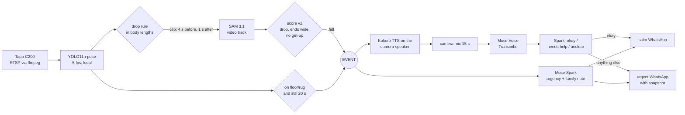

# remy

A fall detector for one elderly person at home, built on a cheap Wi-Fi camera and the Meta Model API.
It watches the room, confirms a fall, asks "Nani, are you okay?" through the camera speaker, listens to
the answer, and tells the family on WhatsApp what happened and what she said.


*Demo GIF to come: a staged fall on the rug, the check-in, and the WhatsApp message.*

## Why

My grandmother lives in a house where nobody is in the room most of the day. Pendants get left on the
table. A camera is already there. The question this project answers is whether "track the person, score the
drop, ask a model to look, then ask her" works well enough to be worth trusting, and what it costs.

## How it works



1. **Watch.** `ffmpeg` pulls the RTSP stream (Python sockets are blocked from the LAN on macOS). YOLO pose runs at
   5 fps on the laptop and keeps a 12 s rolling buffer at 10 fps. Room zones (floor, rug, sofa, bed) come from one
   SAM 3.1 image query at setup time.
2. **Trigger.** A loose rule fires on any fast downward move of the body centroid, measured in body lengths so the
   distance to the camera does not matter. The clip from 4 s before the drop to 1 s after is cut at once.
3. **Confirm.** SAM 3.1 tracks the person in that clip. Score v2 checks the drop again on the clean track, that the
   body ends wide, and that the person has not got up. YOLO keeps watching meanwhile: if she stands up before SAM
   answers, nothing is raised.
4. **Floor rule.** Lying still on the floor or rug for 20 s raises an event even without a visible drop. Lying on
   the sofa or bed does not.
5. **Triage.** Muse Spark gets a 2.5 s burst around the drop plus the tracker numbers and writes the one-line note
   for the family ("Went down fast by the coffee table at 5:45pm and hasn't moved").
6. **Check-in.** The camera speaker says "Nani, are you okay?". The camera mic records 15 s, Muse Voice Transcribe
   turns it into text, Spark decides whether that text is a clear "I'm fine". Only a clear okay is reassuring.
   Silence gets one more prompt; anything unclear escalates at once; a help word escalates without asking Spark.
7. **Alert.** WhatsApp to every number in `family.json`. Calm text for an okay. Urgent text plus a snapshot
   otherwise. If she is still on the floor a minute after saying okay, it asks again.

Every event writes a folder under `events/` with the clip, snapshot, SAM track, score, triage, transcripts and a
timestamped log. A dropped camera stream is reopened with back-off instead of ending the run, and once a day the
family gets a short "Remy is watching" message with uptime and the event count, so silence means nothing happened.

## Which Meta model does what

| model | used for | where |
|---|---|---|
| SAM 3.1 | video tracking of "person" in the candidate clip (box per frame); image segmentation of floor / rug / sofa / bed for the zones | `remy/vision/sam.py`, `remy/vision/zones_setup.py` |
| Muse Spark 1.3 | urgency and the family note from a short burst + tracker numbers; classifying the spoken reply | `remy/triage/spark.py` |
| Muse Voice Transcribe 1.0 | speech to text of the 15 s after the prompt | `remy/checkin/transcribe.py` |
| Glimmer (once added) | the next triage backend to try through the same interface | `remy/triage/base.py` describes the two methods a backend implements |

YOLO11n-pose (ultralytics) runs locally as the always-on first stage, and Kokoro (local ONNX TTS) speaks the prompt.

## Results

### Offline, 100 public clips (40 falls, 60 everyday actions)

| method | falls caught | false alarms |
|---|---|---|
| YOLO trigger alone (what decides to call SAM) | 38/40 | 41/60 |
| SAM 3.1 track + score v1 (round 1 rule) | 25/40 | 1/60 |
| SAM 3.1 track + score v2 (current) | 32/40 | 1/60 |

The eight misses are falls from sitting on the floor (3), onto a bed (2) and from a bed (2), plus one standing
fall with a poor track. Their peak speed is the same as lying down on purpose. The one false alarm is push-ups.
Spark rated the 33 flagged clips: 25 high, 8 medium, none low. Full tables per clip type are in
[`eval/REPORT.md`](eval/REPORT.md).

The thresholds were tuned on this same set, so these numbers are in-sample. [`eval/SENSITIVITY.md`](eval/SENSITIVITY.md)
re-scores the committed tracks over a grid around the chosen point: the speed threshold is the knob that matters
(0.40 gives 34/40 with 2 false alarms, 0.45 gives 32/40 with 1, 0.55 gives 26/40 with 1), while the drop-distance
threshold barely moves anything between 0.10 and 0.20 body lengths. The neighbourhood is flat, not a knife edge.

### Live, on the camera (31 Oct 2026)

Staged falls onto a rug in the living room, times measured from the moment of hitting the rug.

| scenario | SAM confirmed | prompt spoken | heard | WhatsApp sent |
|---|---|---|---|---|
| fall, said "Yeah" | 9.3 s | 12.5 s | "Yeah." → okay | 31 s, calm |
| fall, silent | 8.0 s | 11.2 s | nothing, twice | 50 s, urgent + photo |
| fall, said "help" | 8.5 s | 11.5 s | nothing, then "Hello?" → unclear | 52 s, urgent + photo |

Lying down on the sofa and walking around raised nothing. All alerts arrived on the family phone.

### Latency

| step | typical |
|---|---|
| drop end → clip cut | 1.3 s |
| SAM 3.1 upload + stream (50 frames) | 8 to 10 s |
| prompt spoken on the camera | +3 s |
| recording window | 15 s fixed |
| transcription | 2 s |
| reply classification | 2 s |
| Spark triage (runs in parallel) | 5 to 7 s, one 54 s outlier seen |

So an "okay" message lands about 30 s after the fall and an urgent one after two silent rounds at about 50 s.
SAM is the floor for confirmation; the fixed recording window is the next biggest piece.

### Cost

Everything so far, two evaluation rounds and all live tests included, is $2.55 of API calls. One live event costs
about $0.02: SAM $0.010 (50-frame minimum), Spark triage $0.003, two transcriptions $0.0015, one classification
$0.0014. A false candidate that SAM rejects costs $0.01. YOLO, tracking, scoring and TTS run locally.

## Privacy

- Video never leaves the machine except the clip around a candidate drop (about 5 s) sent to SAM 3.1 and the
  2.5 s burst sent to Spark. Nothing streams continuously to any service.
- Audio is recorded only for the 15 s after the prompt and sent for transcription. The microphone is otherwise
  not read.
- The family gets one snapshot, and only with an urgent alert.
- Events, clips and recordings stay in `events/` on the machine. Keys, phone numbers, the camera's zones and the
  real config are gitignored; the repository holds `.env.example`, `config.example.json` and a placeholder number.
- What Meta keeps from API calls is governed by the Meta Model API terms, not by this project.

## Quickstart

```sh
git clone https://github.com/Sahaj0312/remy.git && cd remy
python3.12 -m venv .venv && . .venv/bin/activate      # or: uv venv
pip install -e .                                      # or: uv pip install -e .
brew install ffmpeg espeak-ng                         # ffmpeg for the camera, espeak-ng for Kokoro
cp .env.example .env && cp config.example.json config.json
```

Then fill in `.env` (Meta API key, camera account, WhatsApp token) and put the real numbers in `family.json`:

```json
{"family": [{"name": "Sahaj", "number": "+1XXXXXXXXXX"}]}
```

Download the go2rtc binary into `tools/go2rtc/go2rtc` and the Kokoro model files into `tools/kokoro/`
(see [docs/hardware-setup.md](docs/hardware-setup.md)), then:

```sh
remy test-checkin --make-prompts        # Kokoro writes audio/checkin_en.wav
remy setup-zones --stream 2             # floor / rug / sofa / bed -> zones.json, check zones_overlay.jpg
remy test-alert --dry-run --test        # alert path without sending; drop --dry-run to send
remy test-checkin --run                 # one spoken check-in round on the camera
remy run --source tapo                  # watch
```

To try it without a camera, simulate with a clip from the eval set (`--no-zones` because the room differs):

```sh
remy run --source eval/clips/gmdcsa_S1_Fall_12.mp4 --realtime --no-zones --audio-out laptop --alerts-dry-run
remy run --source 0 --no-api            # laptop webcam, YOLO trigger only, no API calls, no cost
remy costs                              # the running API ledger
```

`remy run -h` lists the timing flags (`--pre-s`, `--post-s`, `--cooldown-s`, ...). Thresholds live in `config.json`
with a `_comment` block that explains each one.

## Layout

```
remy/            the package
  monitor.py     the live loop: capture, trigger, confirm, event flow (remy run)
  cli.py         remy setup-zones | run | test-checkin | test-alert | costs
  camera/        capture.py (one source, reconnects), rtsp.py (ffmpeg frames/audio), audio_in.py (mic), audio_out.py (speak), go2rtc.py (speaker)
  vision/        yolo.py, tracking.py, sam.py, score.py (v1, v2, trigger), zones.py, zones_setup.py
  triage/        base.py (the interface), spark.py (Muse Spark backend)
  checkin/       tts.py (Kokoro), transcribe.py (Muse Voice Transcribe), classify + ask_once
  alerts/        whatsapp.py (Meta Cloud API or Twilio sandbox), heartbeat.py, webhook.py, media_server.py
  common.py, costs.py
tests/           pytest: scorer on synthetic falls, linker, zones, reply rules, reconnect, heartbeat (`pip install -e ".[dev]" && pytest`)
eval/            labels.csv, the batch scripts, committed tracks/scores/verdicts, REPORT.md, SENSITIVITY.md
docs/            hardware-setup.md
infra/           go2rtc.template.yaml (filled from .env at run time)
experiments/     probes and the v1 live loop, each with a one-line note
```

## Limitations and known misses

- **Falls that look like lying down.** From sitting on the floor, onto a bed, from a bed: 7 of the 8 eval misses.
  The drop is too slow for the rule; the floor rule catches the floor cases only after 20 s of stillness.
- **Hearing.** The camera mic is narrowband and far from the floor. In the live test one "help" was not heard at
  all and the second came back as "Hello?". The policy escalates on both, so the alert still went out, but the
  message said "no clear answer" instead of "asked for help".
- **Fixed 15 s recording.** She says "yeah" in two seconds; the message still waits for the window to close.
- **Latency floor.** SAM takes 8 to 10 s on a 50-frame clip. Nothing in the flow can be faster than that.
- **One camera.** The bedroom is visible only through a doorway. Falls there are far and small.
- **Night.** The eval has 16 night clips; the full live flow has not run in infrared yet.
- **WhatsApp test number.** Recipients must message the number first, the window is 24 h, and the temporary token
  expires daily. A real deployment needs a permanent token and an approved message template.
- **Spark latency spikes.** Triage is usually 5 to 7 s; one 54 s call was seen. It runs in parallel, so the
  check-in is not delayed, but the note can arrive after the alert text is composed.

## Roadmap

1. Stop recording on silence after speech instead of a fixed 15 s; the okay message would land near 20 s.
2. Fuzzy help-word matching and a mic range test, so "help" is heard from the floor.
3. Permanent WhatsApp token, a real sender number, an approved utility template.
4. Try Glimmer as a triage backend through `remy/triage/base.py`.
5. A sitting-fall rule and a second camera for the bedroom.
6. Run as a service (launchd) that restarts the process when it exits after a long outage; a night-mode live test.

## Built during the Meta AI Hackathon (Oct 26 to Nov 4, 2026)

From the commit history:

- **Oct 29.** Feasibility test on 40, then 100 public clips: SAM 3.1 and YOLO tracks with the same schema, score
  v1 (absolute drop, tall before, fixed hold), then score v2 (body lengths, ends wide, get-up check), Spark triage
  with urgency and a family note, the first report, and a live skeleton that ran against clips.
- **Oct 30.** The Tapo C200: RTSP probes, an ffmpeg frame reader to get around the macOS LAN block, audio-lag
  and speaker checks, room zones from SAM image prompts, the go2rtc template. The live v2 flow: SAM starts as soon
  as the clip is cut, Spark gets an inline burst, the floor rule, the spoken check-in with Kokoro, WhatsApp
  alerts. Mask decoding skipped on the live path for speed.
- **Oct 31.** Family numbers moved out of the repo, a Twilio sandbox channel as a fallback while the first WhatsApp
  business account was locked, back to the Meta channel on a second account, the check-in policy tightened (only a
  clear okay reassures, duplicates of one fall suppressed), and the live test on the camera: three staged scenarios,
  three correct alerts.
- **Nov 1.** The scripts folder became this package with a `remy` command, the evaluation moved to `eval/`, and
  this README.

## Data and licenses

Code is MIT (see [LICENSE](LICENSE)). The evaluation uses:

- **UR Fall Detection Dataset** (Kwolek & Kępski 2014), CC BY-NC-SA 4.0,
  https://fenix.ur.edu.pl/mkepski/ds/uf.html. The track and score files under `eval/out/` that derive from
  UR Fall clips (`urfall_*`) inherit that license: attribution, non-commercial, share alike.
- **GMDCSA24** (Alam et al. 2024), MIT,
  https://github.com/ekramalam/GMDCSA24-A-Dataset-for-Human-Fall-Detection-in-Videos.

The clips themselves are not in the repository. Model weights (YOLO11n-pose, Kokoro) and the go2rtc binary are
downloaded separately and carry their own licenses.
